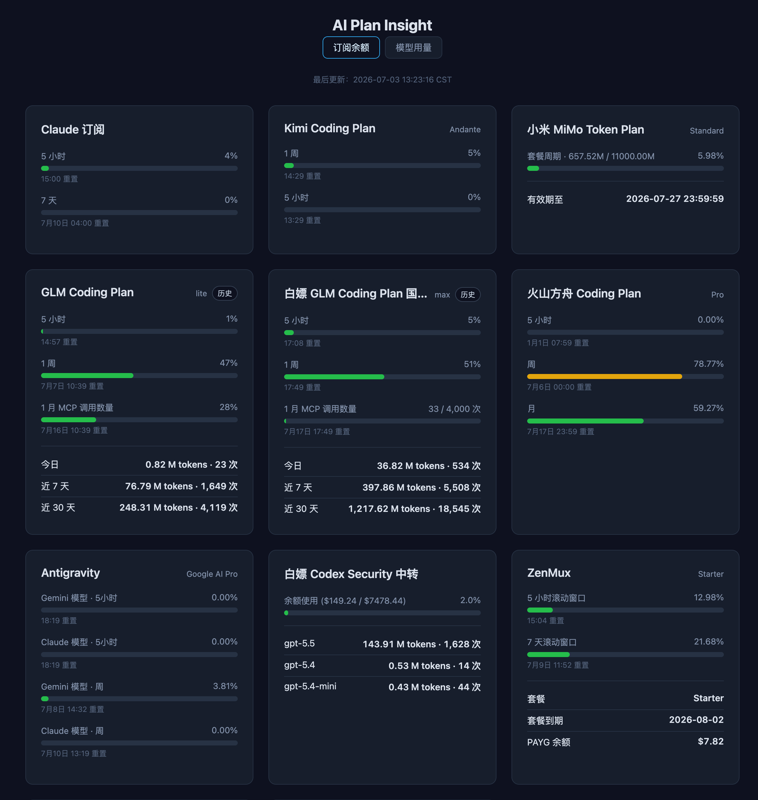
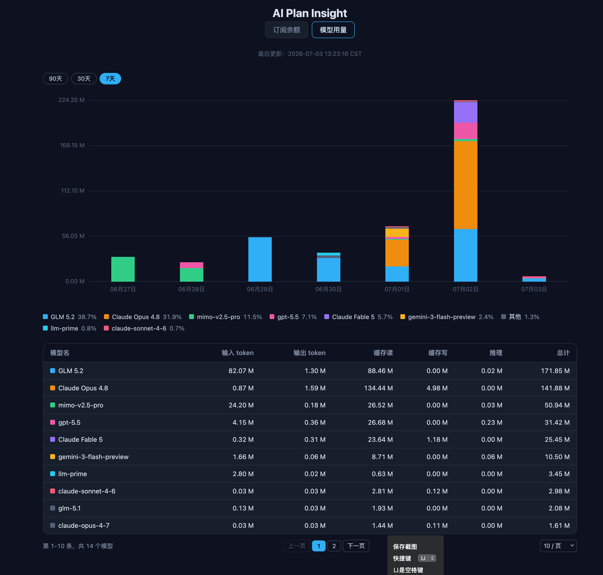

# AI Plan Insight

收集各家 AI Coding Plan 用量的获取方式，聚合查看多个 AI 编码订阅的用量和余额信息。

你可以直接部署本项目作为统一用量面板使用，也可以把本项目拉下来给 Coding Agent 直接参考各家 Plan 的用量获取方式。

## 预览

### 订阅用量总览

以卡片形式聚合展示各 AI Coding Plan 的用量、余额和刷新时间，底部附带 30 天用量趋势图。



### 总模型用量

按供应商汇总各模型的 Token 消耗明细，支持分页浏览历史记录。



## 支持的服务一览

订阅余额通过「Provider 实例」机制获取。每个实例对应一张卡片，同一服务类型可以配置多个实例（例如两个 Claude 账号各一张卡片）。每个实例的采集模式为 `fetch`（面板主动拉取）或 `push`（本地 Agent 推送）二选一。

| 服务 | `type` | 模式 | 凭据 / 说明 | Agent 项目地址 |
|---|---|---|---|---|
| Codex 中转 | `codex` | fetch | Sub2API，配置 `api_key` + `base_url` | — |
| Sub2API | `sub2api` | fetch | 套餐/余额账号，配置 `api_key` + `base_url` | — |
| New API | `new_api` | fetch | New API / One API 架构站点，配置 `api_key` + `base_url` | — |
| 火山方舟 Coding Plan | `volcengine_ark` | fetch | 配置 `access_key_id` + `access_key_secret` | — |
| GLM Coding Plan (智谱) | `bigmodel` | fetch | 配置 `api_key`，支持历史用量视图 | — |
| GLM Coding Plan 国际版 | `bigmodel_international` | fetch | 配置 `api_key` | — |
| Kimi Coding Plan | `kimi` | fetch | 配置 `api_key` | — |
| 华为云余额 | `huawei_cloud` | fetch | 配置 `user_name` + `access_key_id` + `access_key_secret` | — |
| AIPing | `aiping` | fetch | 配置 `api_key` | — |
| ZenMux | `zenmux` | fetch | 配置 `api_key`（Management API Key），同时获取订阅配额与 PAYG 余额 | — |
| Antigravity | `antigravity` | fetch / push | fetch 模式经 [Antigravity Manager](https://github.com/lbjlaq/Antigravity-Manager) 的 API 获取（`api_key` + `base_url`，可选 `admin_password`）；也可用 push 模式由 Agent 推送。原项目未实现周用量读取，可参考我的 [PR #3185](https://github.com/lbjlaq/Antigravity-Manager/pull/3185)（尚未合并）。push 模式可用 gemini-usage-reporter 从 CLIProxyAPI 读取配额推送 | [Antigravity Manager](https://github.com/lbjlaq/Antigravity-Manager) |
| Cursor | `cursor` | push | 通过 Agent 抓取后推送到面板 | [cursor-usage-agent](https://github.com/FlintyLemming/cursor-usage-agent) |
| Claude 订阅 | `claude` | push | 通过 Agent 抓取后推送到面板 | [claude-sub-agent](https://github.com/FlintyLemming/claude-sub-agent) |
| Grok 订阅 | `grok` | push | 通过 Agent 抓取周配额后推送到面板 | — |
| MiMo Token Plan | `mimo_token_plan` | push | 通过 Agent 抓取后推送到面板 | [mimo-usage-agent](https://github.com/FlintyLemming/mimo-usage-agent) |

此外，「总模型用量」表格的数据独立于订阅余额系统，通过 `POST /api/usage/report` 接收各模型的 Token 消耗明细，可使用 [ai-usage-agent](https://github.com/FlintyLemming/ai-usage-agent) 自动抓取并推送。

## 部署

### 拉取镜像

```bash
docker pull ghcr.io/flintylemming/ai-plan-insight:latest
```

### 运行容器

准备一个数据目录（如 `~/ai-plan-insight`），挂载到容器：

```bash
docker run -d \
  --name ai-plan-insight \
  --log-opt max-size=10m \
  --log-opt max-file=3 \
  -p 8000:8000 \
  -v ~/ai-plan-insight:/data \
  -e ADMIN_PASSWORD=换成你自己的密码 \
  ghcr.io/flintylemming/ai-plan-insight:latest \
  python -m ai_plan_insight --web --host 0.0.0.0 --port 8000 --config /data/config.json
```

容器启动后访问 `http://localhost:8000` 查看看板，`http://localhost:8000/admin` 进入管理页（用 `ADMIN_PASSWORD` 登录）。

全部配置与数据都存在 SQLite 数据库 `usage.db` 里，默认生成在 `--config` 指定的同目录（即 `/data/usage.db`）；挂载该目录后重启容器不会丢配置和历史数据。

### Docker Compose

参考 [sample-compose.yaml](sample-compose.yaml)，复制为 `compose.yaml` 后按需修改：

```bash
cp sample-compose.yaml compose.yaml
docker compose up -d
```

### 命令行参数

| 参数 | 说明 |
|---|---|
| `--web` | 以 Web 服务方式运行（默认且唯一模式） |
| `--host` | 监听地址，默认 `127.0.0.1` |
| `--port` | 监听端口，默认 `8765` |
| `--config` | 旧版 `config.json` 的**迁移源**路径；同时决定 `usage.db` 的默认位置。新部署可以指向一个不存在的路径 |
| `--usage-db` | SQLite 数据库路径，默认取 `--config` 同目录下的 `usage.db` |

### 环境变量

| 变量 | 说明 |
|---|---|
| `ADMIN_PASSWORD` | 首次启动时用它初始化管理密码。数据库里已有密码时该变量被忽略（以数据库为准） |
| `ADMIN_PASSWORD_RESET` | 启动时无条件重置管理密码并踢掉所有登录会话。用完请移除该变量并重启 |

未设置管理密码时，管理页会提示「未设置管理密码」，所有管理接口返回 `503`——不存在无密码可访问的窗口。

### 管理页

访问 `http://<host>:<port>/admin`，用 `ADMIN_PASSWORD` 登录后即可维护全部配置，不需要 SSH 到服务器改文件。管理页包含：

- **订阅实例**：新建 / 编辑 / 删除实例，调整排序与启用状态。新建时先选类型，页面会显示该类型的用途说明、支持的模式、以及每个凭据字段的中文标签与获取指引；保存前可以点「测试连接」实际拉一次。
- **用量上报机器**：查看所有通过 `POST /api/usage/report` 上报 Token 用量的设备在线状态、推送认证、最后上报时间、最近 IP、分时段 Token 统计、历史冻结边界及常用模型，并可直接静默或恢复离线告警。
- **模型别名**：把不同来源上报的原始模型 ID 归并到同一个展示名。
- **模型价格**：给上游查不到价的模型手工填单价（USD / 百万 Token），保存后立即生效。
- **推送认证**：`push_auth_secret` 与 `enforce_push_auth`，可一键生成随机 token。
- **显示设置**：配置 push 模式订阅卡片在最后一次推送后多久从面板隐藏（单位小时，最小 0.5），保存后立即生效；fetch 模式卡片不受影响。
- **管理密码**：修改密码，或退出所有设备。
- **导入导出**：整份配置导出为 JSON 备份；导入是整体替换，会二次确认。

实例字段说明：

| 字段 | 必填 | 说明 |
|---|---|---|
| 实例 ID | ✅ | 实例的稳定唯一标识，需匹配 `[A-Za-z0-9._-]+`；push 实例的推送 URL 会用到它。**创建后不可修改**，改名请删除后重建 |
| 类型 | ✅ | 服务类型，取值见上方「支持的服务一览」表，以管理页的类型下拉为准 |
| 模式 | ✅ | `fetch` 或 `push`，只列出该类型支持的选项；只有一种时锁定 |
| 标签 | ✅ | 实例展示标签，卡片标题为 `<服务名> · <标签>` |
| 排序 | ❌ | 卡片显示顺序，数值越小越靠前，默认 `999` |
| 启用 | ❌ | 停用的实例对运行时完全不存在——不拉取、不上卡片、推送到它返回 404 |
| 凭据 | 按类型 | 按所选类型动态渲染，必填项带星号 |

改动在管理页保存后立即生效，不需要重启服务。若某一行配置因为版本升级而变得非法（比如某个类型被移除），该行会在管理页标红并附上原因，其余实例照常工作。

### 从旧版迁移（config.json → 数据库）

从 v0.12 及更早版本升级时不需要任何手工操作：

1. 启动时如果 `--config` 指向的 `config.json` 存在，且数据库里还没有任何配置，面板会自动把 `providers`、`model_aliases`、`push_auth_secret`、`enforce_push_auth` 全部导入数据库。
2. 导入成功后，原文件会被改名为 `config.json.bak`（若该名字已被占用则加时间戳后缀，如 `config.json.bak.20260727-103000`）。
3. 看板与管理页顶部会各显示一条迁移结果提示，包含导入的实例数、别名数、备份文件名，以及因配置非法而被跳过、需要手工重新添加的实例。点「知道了」后不再提示。

几种边界情况：

- **数据库里已有配置**：不迁移、不改名，只在日志里 warning，并在页面顶部常驻提示「检测到 config.json，已忽略，配置以数据库为准」。确认无用后手动删除该文件即可消除提示。
- **`config.json` 解析失败**：不迁移、不改名，页面提示解析错误原文。修好文件后重启，或直接在管理页手工录入。
- **备份改名失败**（只读挂载等）：配置已经进了数据库，不会回滚；日志记 error，下次启动会走「数据库里已有配置」分支，不会重复导入。

[config.json.example](config.json.example) 保留，仅用于从旧版迁移时参考格式，新部署不需要它。

## 数据获取逻辑（订阅余额）

- **fetch 实例**：后台每 30 秒并发刷新所有 fetch 实例，每个实例请求前会先等待 0–3 秒的随机抖动，避免同站点的多个实例每轮同时发起请求。某个实例连续失败时，前两次沿用上一次成功结果，第三次起卡片显示错误信息；单个实例失败不影响其他实例。
- **限流退避**：某个实例返回 HTTP 429 时，该实例会被跳过一段时间（默认 60s、120s、240s… 指数递增，上限 15 分钟；若响应带 `Retry-After` 则以该值为准），期间卡片沿用上一次结果。请求成功后退避状态立即清零。退避只作用于触发限流的实例。
- **push 实例**：数据保留 30 分钟。若 30 分钟内未收到新的推送，对应卡片将从页面消失，直到再次推送。同一类型的多个实例互不覆盖。
- **持久化**：每个实例的最新卡片状态写入 SQLite 快照，重启后自动恢复（push 快照恢复后仍按 30 分钟有效期判断；已从配置中删除的实例不会恢复）。

## 模型价格

「总模型用量」的 USD 成本按每个原始模型 ID 的单价计算，价格自动依次查 LiteLLM → OpenRouter → models.dev，本地缓存 24 小时。三个源都查不到的模型只统计 Token，成本列留空。

供应商自有前缀的模型（`cursor-grok-4.5-high-fast` 这类各家的加速通道、Cursor 的 `cursor-*` 系列）不会出现在任何上游源里，可以在管理页的「模型价格」面板手工补价：

- 面板按最近 90 天的实际用量列出上游查不到价的模型 ID，不需要手抄；已填过价的条目始终留在表里，可以随时改价或清空。
- 单价单位是 **USD / 百万 Token**，与各家定价页一致，可直接照抄。
- 手填价格优先于全部上游源，只对完全相同（忽略大小写）的模型 ID 生效，**不做通配或前缀匹配**——同一系列的加速通道和普通通道价格不同，一条规则盖一片正是要避免的。
- 一行四个价格全部留空并保存 = 删除该条覆盖；只填缓存价、输入和输出都为 0 的条目会被拒绝。
- 价格存在数据库里，保存后立即生效、不需要重启，并且包含在导入导出的备份中（导入是整体替换，导入一份不含 `model_prices` 的旧备份会清空价格表）。

## API

Web 模式下提供以下接口。

订阅余额：

- `GET /api/usage/v2` — 返回所有实例的卡片数据；未配置或配置无效时返回空数组
- `GET /api/status/v2` — 返回 `enabled`（是否启用）、`last_updated`（最近刷新时间）、`config_error`（顶层配置错误信息）、`instance_errors`（被跳过实例的错误映射，含未知 `type`，余额页上方会提示有几个实例被忽略）
- `POST /api/push/v2/{instance_id}` — 接收 push 实例的用量推送

模型 Token 用量：

- `POST /api/usage/report` — 接收各模型的 Token 消耗明细
- `GET /api/usage/timeseries?days=30` — 返回用量趋势数据，`days` 支持 7 / 30 / 90
- `GET /api/sources/stale` — 列出超过 24 小时未上报的推送来源（Agent 存活告警）
- `POST /api/sources/{source_id}/dismiss-stale` — 关闭某个来源的告警，直到它再次上报
- `GET /api/admin/sources` — 返回各推送来源的认证状态（需登录）
- `GET /api/admin/usage-sources` — 返回各用量上报机器的状态、认证、最近 IP 与统计明细（需登录）

管理接口：`/api/admin/*` 全部需要登录（`GET /api/admin/session` 与 `POST /api/admin/login` 除外）。`GET /api/notices` 与 `POST /api/notices/migration/dismiss` 是公开的只读提示接口，不含任何凭据。只读看板与两个推送接口的鉴权方式没有变化。

## 用量推送 (Push API)

对于 `mode` 为 `push` 的实例，由本地 Agent 将用量数据推送到：

```text
POST /api/push/v2/{instance_id}
Authorization: Bearer <push_auth_secret>
Content-Type: application/json
```

`instance_id` 即在管理页创建实例时填写的实例 ID，必须预先创建；请求 body 按实例的 `type` 使用对应的 payload 格式。错误响应：

| 状态码 | 含义 |
|---|---|
| `503` | 订阅余额配置不存在或无效 |
| `404` | `instance_id` 未在配置中声明 |
| `422` | 目标实例是 fetch 实例，或 body 不符合该类型的格式 |
| `401` | 已启用 `enforce_push_auth` 且 token 缺失或错误 |

以下示例中的实例 ID（如 `claude-personal`）请替换为自己配置中的实际 key。

### 推送 Claude 订阅用量（type: claude）

分别传入 `seven_day` 与 `five_hour` 的用量百分比 (`utilization`) 和重置时间 (`resets_at`，ISO8601 字符串，窗口未激活时可为 `null`)；若本地抓取遇到 401 鉴权失效，也可推送 `{"error": "需要重新登录"}`，面板卡片会高亮提示重新登录，直到重新推送正常用量数据。

```bash
curl -X POST http://localhost:8000/api/push/v2/claude-personal \
  -H "Authorization: Bearer your-secret-token" \
  -H "Content-Type: application/json" \
  -d '{
    "seven_day": {
      "utilization": 45.2,
      "resets_at": "2026-07-08T12:00:00Z"
    },
    "five_hour": {
      "utilization": 12.8,
      "resets_at": "2026-07-01T15:00:00Z"
    }
  }'
```

### 推送 Grok 订阅用量（type: grok）

传入周配额（对齐 Grok CLI / pi-grok-cli）：

- `weekly`：用量百分比（`utilization` / `resets_at`），必填
- `plan`：可选订阅档位展示名（如 `SuperGrok`），空白会被忽略

缺 `weekly` 会返回 422。旧 Agent 若仍附带 `monthly` 字段会被忽略。

```bash
curl -X POST http://localhost:8000/api/push/v2/grok-main \
  -H "Authorization: Bearer your-secret-token" \
  -H "Content-Type: application/json" \
  -d '{
    "weekly": {
      "utilization": 45.2,
      "resets_at": "2026-07-10T04:01:09Z"
    },
    "plan": "SuperGrok"
  }'
```

### 推送 Cursor 用量（type: cursor）

传入 `membership`、`autoPercentUsed`、`apiPercentUsed` 和 `billingEnd`。

```bash
curl -X POST http://localhost:8000/api/push/v2/cursor-main \
  -H "Authorization: Bearer your-secret-token" \
  -H "Content-Type: application/json" \
  -d '{
    "membership": "Pro",
    "autoPercentUsed": 45.5,
    "apiPercentUsed": 12.3,
    "billingEnd": "2026-07-01T00:00:00Z"
  }'
```

### 推送 MiMo 用量（type: mimo_token_plan）

卡片标题以配置中的 `label` 为准，body 中的 `provider` 字段不会覆盖它。

```bash
curl -X POST http://localhost:8000/api/push/v2/mimo-main \
  -H "Authorization: Bearer your-secret-token" \
  -H "Content-Type: application/json" \
  -d '{
    "user_id": "your_user_id",
    "membership_level": "Premium",
    "limits": [],
    "balances": {}
  }'
```

### 推送 Antigravity 用量（type: antigravity）

`windows` 按顺序逐条渲染为进度条，每条是一个模型组的一个配额窗口：

- `group`：模型组短名，卡片上显示为 `{group} 模型 · 5小时/周`（如 `Claude`、`Gemini`）
- `window`：`5h` 或 `weekly`
- `utilization`：已用百分比（0–100）
- `resets_at`：重置时间（ISO8601 字符串），可为 `null`

`plan` 为可选的订阅档位展示名（如 `Google AI Ultra`）。`windows` 为空时返回 422；Agent 侧取数失败时可推送 `{"error": "..."}`，卡片会显示该错误，直到再次推送正常数据。可使用 `gemini-usage-reporter`（经 CLIProxyAPI 读取 Antigravity 账号配额）自动推送。

```bash
curl -X POST http://localhost:8000/api/push/v2/antigravity \
  -H "Authorization: Bearer your-secret-token" \
  -H "Content-Type: application/json" \
  -d '{
    "plan": "Google AI Ultra",
    "windows": [
      {"group": "Claude", "window": "5h", "utilization": 25.0, "resets_at": "2026-11-25T11:21:31Z"},
      {"group": "Claude", "window": "weekly", "utilization": 10.0, "resets_at": "2026-12-02T06:21:31Z"},
      {"group": "Gemini", "window": "5h", "utilization": 0.0, "resets_at": "2026-11-25T11:21:45Z"}
    ]
  }'
```

> 旧版扁平格式（`gemini_3_1_pro_percentage` 等字段）已移除，按旧格式推送会返回 422。

### 推送模型 Token 用量

将各模型的 Token 消耗明细推送到面板，汇总展示在「总模型用量」表格中。可使用 [ai-usage-agent](https://github.com/FlintyLemming/ai-usage-agent) 自动抓取并推送。

```bash
curl -X POST http://localhost:8000/api/usage/report \
  -H "Authorization: Bearer your-secret-token" \
  -H "Content-Type: application/json" \
  -d '{
    "source_id": "my-agent",
    "source_label": "My Agent",
    "reported_at": "2026-07-03",
    "points": [
      {
        "date": "2026-07-03",
        "model_id": "claude-3-5-sonnet",
        "input_tokens": 15000,
        "output_tokens": 8000,
        "cache_read_tokens": 5000,
        "cache_write_tokens": 2000,
        "reasoning_tokens": 1000
      }
    ]
  }'
```

**参数说明：**

| 字段 | 类型 | 必填 | 说明 |
|---|---|---|---|
| `source_id` | string | ✅ | 推送来源标识，用于区分不同 Agent |
| `source_label` | string | ❌ | 推送来源的显示名称 |
| `reported_at` | string (YYYY-MM-DD) | ❌ | Agent 运行日期，该日期之前的数据将被冻结（不可修改） |
| `points` | array | ✅ | Token 用量明细列表 |
| `points[].date` | string (YYYY-MM-DD) | ✅ | 用量日期 |
| `points[].model_id` | string | ✅ | 模型标识符 |
| `points[].input_tokens` | int | ✅ | 输入 Token 数 |
| `points[].output_tokens` | int | ✅ | 输出 Token 数 |
| `points[].cache_read_tokens` | int | ❌ | Cache Read Token 数，默认 0 |
| `points[].cache_write_tokens` | int | ❌ | Cache Write Token 数，默认 0 |
| `points[].reasoning_tokens` | int | ❌ | Reasoning Token 数，默认 0 |

若某个来源超过 24 小时未上报，页面会显示 Agent 存活告警，可通过 `POST /api/sources/{source_id}/dismiss-stale` 手动关闭。

## 推送认证

所有推送接口支持 Bearer Token 认证：

```text
Authorization: Bearer <push_auth_secret>
```

`POST /api/push/v2/{instance_id}` 与 `POST /api/usage/report` 共用唯一的 `push_auth_secret`，所有 push 实例与模型用量上报使用同一个 token。在管理页的「推送认证」区设置，可一键生成随机值。

`enforce_push_auth` 为 `false`（默认）时，token 缺失或错误的请求仍会被接受，只记录为未认证，便于逐个迁移客户端；全部客户端更新完毕后在管理页勾选「强制校验」，未认证请求将返回 `401 Unauthorized`。

对于模型用量上报，可通过 `GET /api/admin/sources` 查看各来源的认证状态；当所有 `auth_valid` 都为 `true` 时即可放心开启强制校验。
